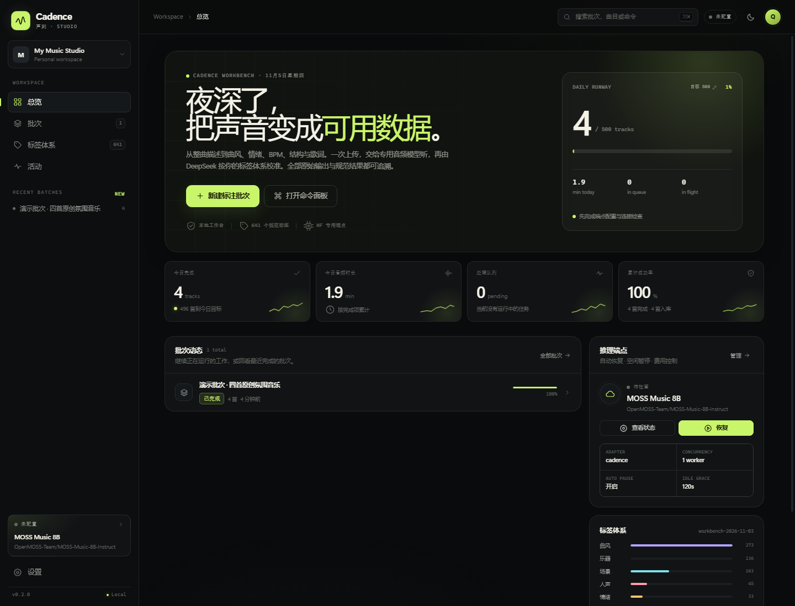
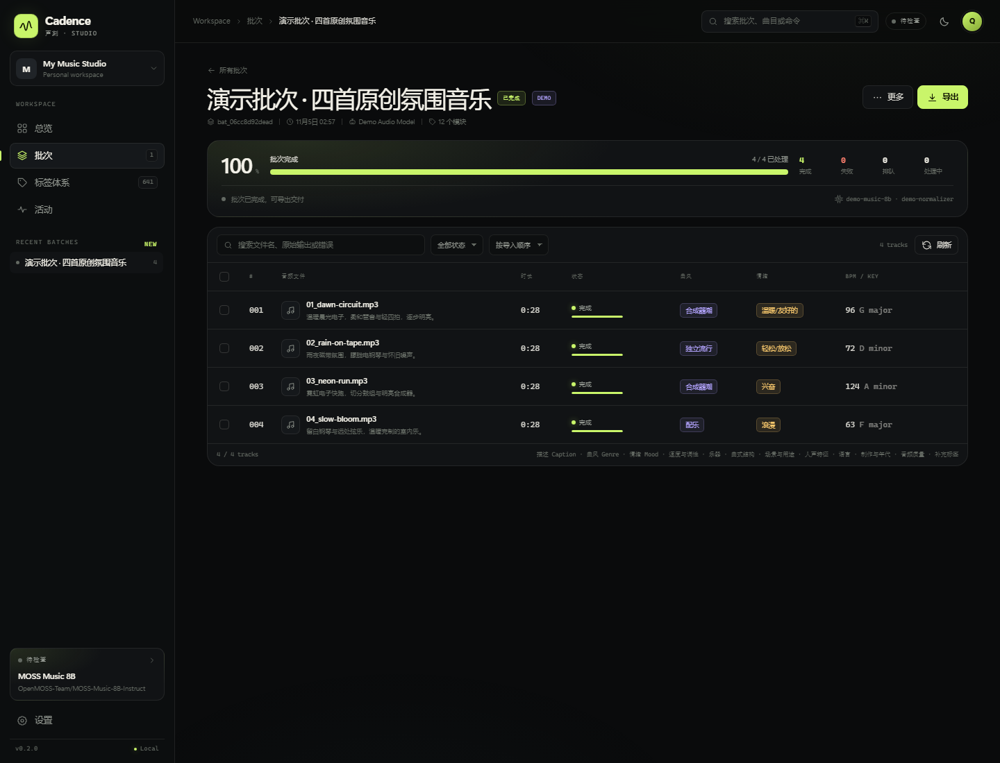
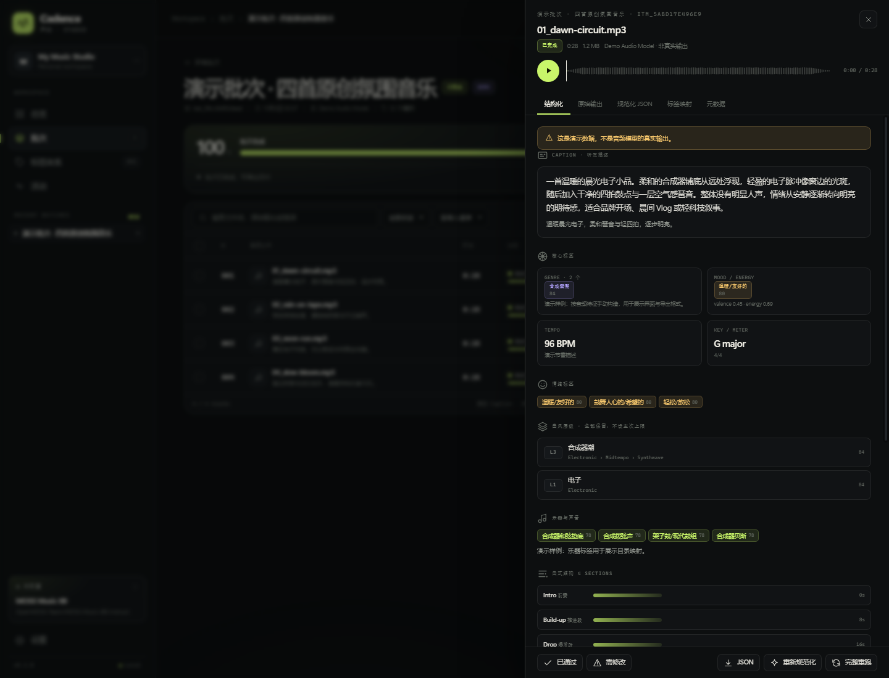
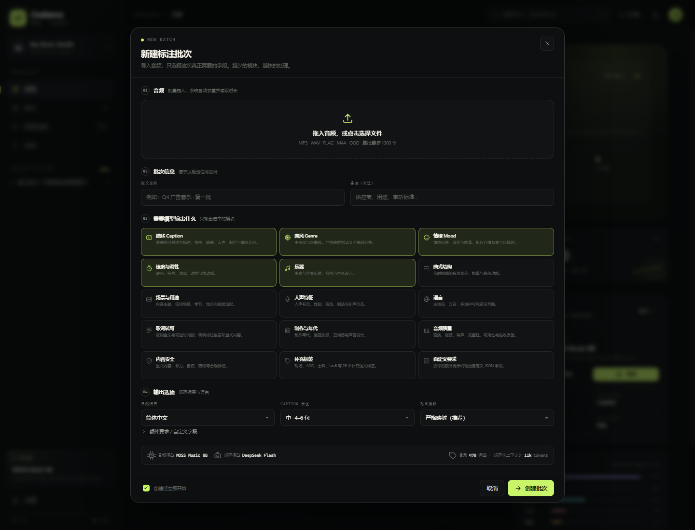
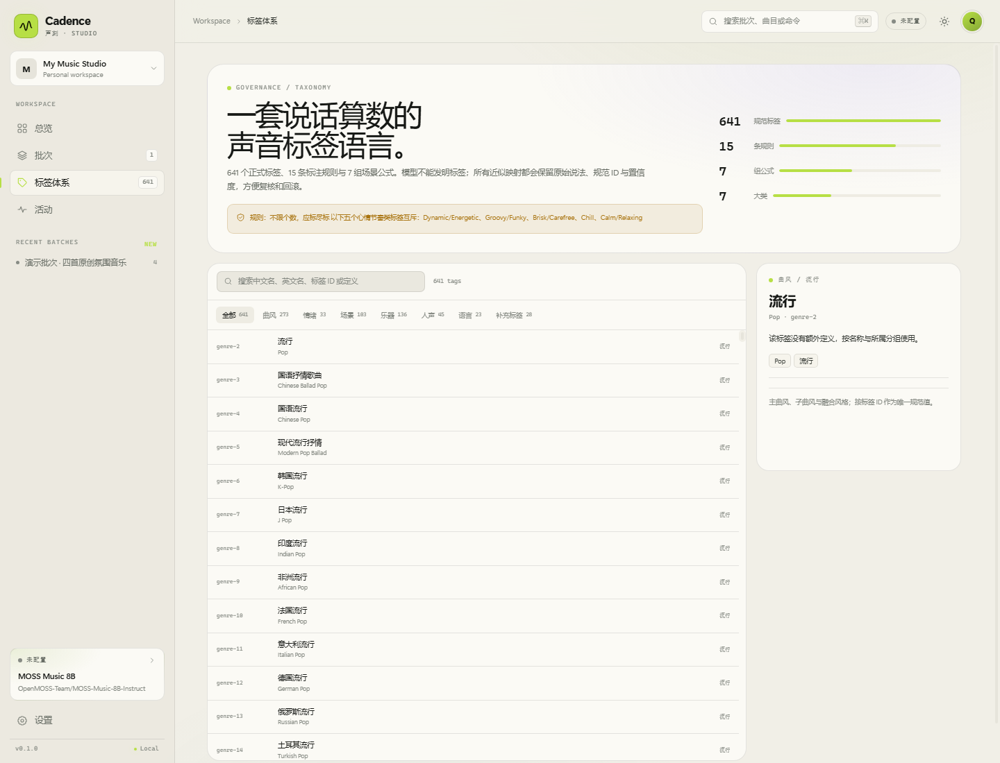

# Cadence Studio · 声刻

**企业级、本地优先的 AI 音乐 / 音频标注工作台。**
把专用音频理解模型、可治理的标签体系、批量队列与可交付导出放进一个双击即用的界面。

> 当前版本：`0.2.2` · 标签体系：`workbench-2026-11-03`（741 tags / 15 rules / 7 formulas）
>
> **重要状态**：工作台、队列、标签治理、导出与自定义推理服务已完成并通过本地端到端测试；**尚未在真实 A10G / Hugging Face Endpoint 上验证显存、吞吐和模型质量**。首次部署请只跑 1 首，按 [基准测试计划](docs/quality/benchmark.md)记录结果。



## 它解决什么问题

传统“打标签”工具把模型输出、标签规范、批次进度和交付格式拆成四个地方。Cadence Studio 把它们放在同一条可追溯流水线里：

```text
音频 → 私有 HF Inference Endpoint（MOSS-Music / Music Flamingo）
     → 原始观察（保留）
     → DeepSeek 按标签目录与规则规范化
     → 结构化 JSON（只含你请求的字段）
     → 人工抽检 / 复核
     → XLSX / JSON / Markdown / CSV / ZIP
```

- **按需输出**：只要 Caption 就只返回 Caption；不会夹带曲风、BPM。模块可自由组合。
- **双轨结果**：每条音频都保留音频模型原文、规范化模型原文、最终 JSON 与标签映射。
- **曲风层级**：标签浏览器先列一级曲风（01、02…），点箭头展开二级/三级；结果输出 `Pop › K-Pop` 这样的路径，一首歌有几个曲风就保留几个，不强制单个主曲风；补充曲风随 Genre 默认进入规范化目录。
- **稳定 ID 与人类序号分离**：展示序号从 1 开始；`genre-2` 这类 ID 是机器稳定标识，不随展示序号变化。
- **只约束大模型**：音频模型收到的是原生任务提示（如“列出所有曲风”），**不接收 741 标签目录、标签 ID 或标准结构词表**；只有 DeepSeek 读取规范文档并做映射与校验。
- **标签治理**：741 个正式标签只允许目录内 ID；近似标签（如 `Modal Jazz`）会留下原词、规范 ID 与置信度，不会静默改写。目录外的乐器/音色保留到 `instruments.additional`，不因映射不到 ID 而丢失。
- **独立标签语言**：曲风、情绪、场景、乐器、人声、语言、补充标签可分别选择中文或 English；界面与 XLSX/CSV/Markdown 导出共用这套设置，Caption 正文由批次输出语言单独控制。
- **DeepSeek 项目规则**：新批次可填写整批共用的项目规则，并上传 docx/pdf/xlsx/txt/md/csv/json 参考资料；DeepSeek 先理解规则并生成音频模型提示词，参考资料不会直接进入音频模型。
- **批量生产**：持久化队列、自动重试、暂停/继续、断点恢复、SSE 实时进度；每日目标可随时修改。
- **端点费用守卫**：批次开始时自动 Resume，队列一空即自动 **Scale to zero**；界面始终显示当前 State。
- **硬件推荐**：T4 / L4 / A10G / L40S / A100 / H100 / H200 / RTX PRO 6000 预设并发、音频上限、超时与参考价格。
- **多格式输入**：音频以及 MP4 / MOV / MKV / WEBM 等常见视频容器；视频自动抽取音轨，原始文件保留。
- **本地数据**：音频、结果、SQLite、导出文件和密钥都在本机；API Key 使用 Windows DPAPI 加密。
- **可交付导出**：XLSX 工作簿、JSON 数据包、Markdown 报告、CSV 平表和完整 ZIP。

## 界面

| 批次工作台 | 单曲审听抽屉 |
| --- | --- |
|  |  |

| 新建批次 | 标签体系 |
| --- | --- |
|  |  |

设计语言：深色石墨 + 信号青柠，纸感浅色主题，键盘优先（`⌘/Ctrl+K` 命令面板，`N` 新建批次），不使用外部字体或 CDN。

## 快速开始（Windows）

### 方式 A：双击 EXE（已有构建）

直接双击 **`dist\CadenceStudio.exe`**：

- 会出现一个小型 “Cadence Studio” 控制窗；
- 点击 **打开工作台**，或等待浏览器自动打开；
- 关闭控制窗即停止本地服务；
- 首次启动创建 `%LOCALAPPDATA%\CadenceStudio` 数据目录，不影响仓库。

### 方式 B：双击脚本（源码运行）

1. 确认已安装 Python 3.11+（推荐 3.12），并且 `ffmpeg` / `ffprobe` 在 PATH 中。
2. 双击仓库根目录的 **`启动 Cadence.cmd`**。
3. 首次启动会创建 `.venv` 并安装依赖，随后浏览器自动打开工作台。
4. 打开 **设置 → 推理端点**，填入 Hugging Face Token、Namespace、Endpoint 名称；在 **文字模型** 使用 `deepseek-flash` 与 DeepSeek API Key。
5. 点 **验证令牌** / **测试**，然后新建批次。

> 如果 `8765` 被占用，启动器会自动使用 `8766–8794`。关闭终端窗口即停止服务。
> 重新构建 EXE：`powershell -ExecutionPolicy Bypass -File scripts\build_windows.ps1`。

### 方式 C：开发者启动

```powershell
python -m venv .venv
.\.venv\Scripts\python.exe -m pip install -e ".[dev]"
$env:PYTHONPATH="src"
.\.venv\Scripts\python.exe -m cadence_studio --no-browser
# http://127.0.0.1:8765/
```

没有端点也可以先点 **载入演示批次**：四首由本地合成的原创片段，结果明确标记为 `DEMO`，用于检查界面、数据结构和导出格式。

## 部署两个模型

> **不要**从模型页选择 vLLM / SGLang 托管引擎直接部署。当前两个模型在 HF 专用端点的托管引擎上都不可直接服务：MOSS 需要 fork 的 SGLang，Music Flamingo 的 vLLM 支持在 2026 年被移除。推荐 **自定义容器**。

仓库包含一个统一推理容器：

```text
deploy/inference-endpoint/
  Dockerfile               # 每个模型一个镜像
  server.py                # /health + /v1/annotate
  requirements-moss.txt
  requirements-flamingo.txt
```

```powershell
docker buildx build --platform linux/amd64 `
  -f deploy/inference-endpoint/Dockerfile `
  --build-arg MODEL_FAMILY=moss `
  -t your-docker-user/cadence-moss:0.1 deploy/inference-endpoint

docker push your-docker-user/cadence-moss:0.1
```

然后在 Hugging Face 创建 Endpoint：

| 字段 | MOSS | Music Flamingo |
| --- | --- | --- |
| Model repository | `OpenMOSS-Team/MOSS-Music-8B-Instruct` | `nvidia/music-flamingo-2601-hf` |
| Task / engine | Custom / Custom container | Custom / Custom container |
| Image | 你的 MOSS 镜像 | 你的 Flamingo 镜像 |
| Port | `8000` | `8000` |
| Health route | `/health` | `/health` |
| Hardware | A10G 24GB（首次验证；可能 OOM） | A10G 24GB（首次验证） |
| Replicas | min 0 / max 1 | min 0 / max 1 |
| Scale-to-zero | 15 minutes | 15 minutes |
| Access | Private | Private |

环境变量：`MODEL_FAMILY=moss`（或 `flamingo`）、`MAX_AUDIO_SECONDS=1200`、`MAX_NEW_TOKENS=1024`。完整步骤、Token 权限、A10G 风险、成本与容量计算见 **[Hugging Face 端点部署教程](docs/operations/huggingface-setup.md)**。

> A10G 24GB 只是首个测试候选，不是已验证配置。8B 权重约 16–18GB；4 分钟音频、长上下文和输出可能触发 OOM。首个真实测试必须记录 GPU、模型 revision、音频长度、耗时与账单。若 OOM，使用 48GB 卡、缩短音频，或仅试验性开启 4-bit。**设置 → 推理端点 → 硬件预设**会按卡型给出并发、音频上限与参考价，但仍是推荐值，不是实测保证。
>
> Music Flamingo 模型卡标注 **NVIDIA OneWay Noncommercial License**；商业使用前请自行核对许可。MOSS-Music 为 Apache-2.0。

## 每日目标与容量

每日目标不是固定 500：可在 **总览 → Daily runway → 目标** 或 **设置 → 工作区** 随时修改。目标只影响进度展示，不决定实际吞吐。

按 3–4 分钟/首、单卡 batch=1 估算：

| 单首端到端 | 500 首所需 GPU 时间 | 单 A10G 结论 |
| --- | ---: | --- |
| 60 s | 8.3 h | 有余量，但仍受上传/LLM 影响 |
| 90 s | 12.5 h | 可行，接近单卡日容量 |
| 150 s | 20.8 h | 只能在 24h 内勉强完成，不适合工作日交付 |
| 240 s | 33.3 h | 单卡不可行，需要第二张卡/第二端点或缩短音频 |

上表是容量算术，不是实测。参考模型卡与公开信息，8B 音频模型 3–4 分钟整曲在 A10G 上很可能需要数十秒到数分钟。系统为这个场景做了四件事：

1. 音频模型只收到约 800 字的任务提示，不接收 741 个标签目录；
2. 规范化阶段才注入标签目录，且只注入选中的类别；
3. 上传前转码为紧凑 MP3，减少传输；
4. 持久队列支持过夜运行，失败自动重试，端点空闲自动缩容到零。

要稳定完成较高的日目标，建议两条端点（MOSS + Flamingo）各 1 并发，总计 2 路；或使用更大显存/更高吞吐的卡。**不要**在单张 A10G 上把并发设为 2，显存会直接竞争。硬件预设与依据见 [基准测试计划](docs/quality/benchmark.md)。

## 项目结构

```text
src/cadence_studio/
  api.py             HTTP API（批次、项目、设置、端点、导出、SSE）
  app.py             FastAPI 应用与本地访问保护
  config.py          路径、默认配置、原子保存
  db.py              SQLite schema / repository
  pipeline.py        持久队列、并发、重试、端点自动缩容到零
  inference.py       音频端点适配器（cadence multipart / OpenAI audio）
  llm.py             OpenAI-compatible 规范化客户端
  normalizer.py      JSON 提取、标签校验、互斥规则、映射追踪
  prompts.py         音频提示词与规范化提示词
  taxonomy.py        741 标签、别名、模糊匹配、紧凑目录
  exports.py         XLSX / JSON / MD / CSV / ZIP
  media.py           ffprobe/ffmpeg、上传、转码、演示音频
  demo.py            首启演示批次
  web/               index.html / app.css / app.js / favicon
deploy/inference-endpoint/   自定义推理容器
docs/                          产品、架构、运维、质量、API 文档
tests/                         pytest（标签、提示词、API、导出）
tools/build_taxonomy.py        从快照生成规范化 taxonomy.json
```

## 文档地图

- [产品与字段契约](docs/product/annotation-schema.md)
- [行业标注任务全景（25 类，含平台/标准引用）](docs/product/industry-taxonomy.md)
- [用户操作指南](docs/product/user-guide.md)
- [Windows 快速开始](docs/operations/quickstart.md)
- [Hugging Face 端点部署（新手版）](docs/operations/huggingface-setup.md)
- [硬件预设与并发推荐](docs/operations/hardware-presets.md)
- [DeepSeek 配置](docs/operations/deepseek-setup.md)
- [系统架构](docs/architecture/system.md) / [数据模型](docs/architecture/data-model.md)
- [容量、成本与基准](docs/quality/benchmark.md)
- [故障排查](docs/operations/troubleshooting.md)
- [API 参考](docs/api/reference.md)
- [标签原文](docs/product/taxonomy-reference.md)

## 安全与数据

- 仅监听 `127.0.0.1`，拒绝非本机 Host 与跨站写请求。
- 密钥使用 Windows DPAPI 加密，绑定当前 Windows 用户与电脑；HTTP API 永不返回明文。
- 音频只发送到你配置的推理端点；文字观察只发送到你配置的规范化模型。系统没有隐藏的第三方上传。
- `data/`、`outputs/`、`runtime/` 和 `.env` 均已排除在 Git 之外。不要提交音频、密钥、数据库或导出文件。
- 备份：设置 → 数据与安全 → 备份数据库。完整备份还应包含 `data/audio/` 和 `data/config.json`。
- 这是一个**本机单用户**工作台，不应直接暴露到公网。

## 许可与边界

代码为专有源码，详见 `LICENSE`。标签定义的来源与分发权由使用者确认。MOSS-Music 与 Music Flamingo 的权重、模型代码和服务条款分别适用其自身许可；模型输出是概率性建议，不能替代人工审听、版权核查或权利结算。

## 维护

```powershell
.\.venv\Scripts\python.exe -m pytest -q
node --check src\cadence_studio\web\app.js
.\.venv\Scripts\python.exe tools\build_taxonomy.py
```

提交前请阅读 [CONTRIBUTING.md](CONTRIBUTING.md) 与 [AGENTS.md](AGENTS.md)。
