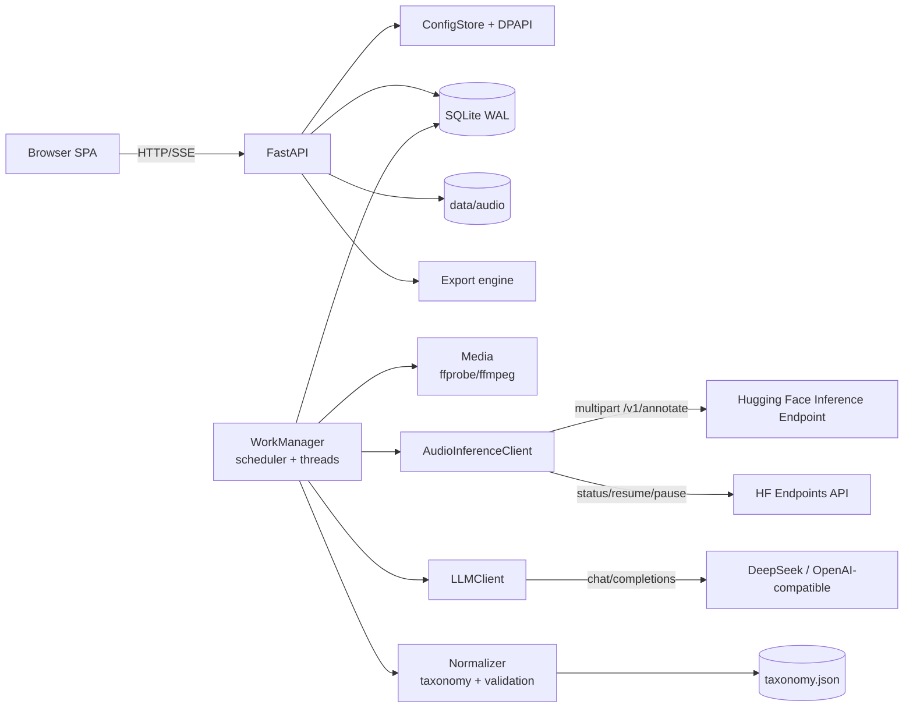
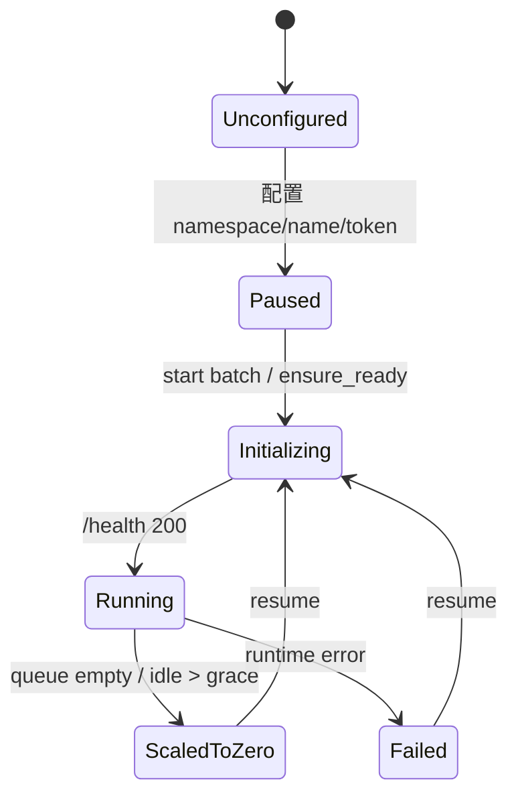

# 系统架构

## 1. 定位

Cadence Studio 是一个**本地控制面 + 云端模型面**的标注工作台：

- 本地：Web UI、SQLite、音频文件、队列、标签治理、导出、密钥。
- 云端：Hugging Face Inference Endpoint 上的音频理解模型；DeepSeek 的文字规范化。
- 不依赖浏览器之外的第三方前端、CDN 或账号系统；默认只监听 `127.0.0.1`。

## 2. 组件



| 组件 | 文件 | 职责 |
| --- | --- | --- |
| Web SPA | `web/` | 无构建步骤的原生 JS；视图、表格、抽屉、设置、命令面板 |
| API | `api.py` | 批次、项目、设置、端点动作、导出、SSE、演示 |
| App | `app.py` | lifespan、静态资源、本地访问保护、安全响应头 |
| Config | `config.py` | 路径、默认设置、原子写入、公开脱敏 |
| Secrets | `secrets.py` | Windows DPAPI；非 Windows 开发降级 |
| DB | `db.py` | SQLite schema、查询、事件、用量 |
| Queue | `pipeline.py` | 取任务、并发、重试、恢复、自动 scale-to-zero |
| Inference | `inference.py` | `cadence` multipart 适配器与 OpenAI audio 适配器 |
| LLM | `llm.py` | OpenAI-compatible JSON 调用、重试、错误分类 |
| Prompts | `prompts.py` | 任务提示、目录提示、规范化 JSON 契约 |
| Normalizer | `normalizer.py` | JSON 提取、标签校验、互斥、时间裁剪、映射 |
| Taxonomy | `taxonomy.py` | 741 标签加载、别名解析、紧凑目录、规则 |
| Media | `media.py` | 上传、探测、转码、演示音频 |
| Exports | `exports.py` | XLSX/JSON/MD/CSV/ZIP；曲风层级列 |
| Hardware presets | `hardware.py` | T4–H200 的并发/音频上限/参考价 |

## 3. 请求流程

### 3.1 创建批次

```text
Browser multipart
  → 校验文件扩展名/大小
  → 流式落盘到 data/audio/{batch_id}/
  → ffprobe 读取时长/采样率/声道
  → SHA-256 去重
  → SQLite: batches + items
  → 可选 auto_start: WorkManager.start_batch
  → 返回 batch + warnings
```

批次创建时冻结：

- `spec`（模块、语言、长度、自定义要求）
- `route_snapshot`（音频模型 / 文字模型路由 ID、名称、模型）
- 创建时间、文件名、SHA-256、音频技术信息

### 3.2 项目规则与参考资料

新批次可携带整批共用的 `project_instruction` 和 `project_context`：

- `project_files` 上传后由 `documents.py` 提取文字（docx / 数字版 PDF / xlsx / 纯文本）；
- 有规则或上下文时，创建批次先调用规范化 LLM 生成 `audio_model_prompt`；
- 音频模型只收到生成的提示词；原始参考资料只进入规划与规范化阶段；
- 文本长度有上限，扫描版 PDF 无文字时返回 warning，不做 OCR。

### 3.3 曲风层级

- 标签表为每个 Genre 计算 `genre_parent_id`、`genre_level`、`genre_lineage`。
- 例：K-Pop 的 path=`Pop`，父级为 Pop，level=2；输出 `path=["Pop","K-Pop"]`。
- `genre.items` 完整保留模型观察到的多个曲风；`primary`/`secondary` 只是展示投影，不参与删减。
- `Extra` 是补充曲风词表，默认随 Genre 注入规范化目录；音频模型不会被单独提醒。

### 3.4 单项处理

```text
claim (queued → preprocessing)
  → 探测 / 转码 96kbps mp3
  → 组装音频提示（不含 741 目录）
  → ensure endpoint ready（必要时 resume）
  → POST /v1/annotate
  → 保存 raw_text
  → 组装规范化提示（只含选中类别）
  → LLM JSON
  → Normalizer 校验（ID/互斥/数值/时间）
  → 保存 normalized_json + summary + timings
  → completed
```

失败：

- 保留 `raw_text`（如果推理已成功）；
- 分类 `error_code`；
- 可重试错误按指数退避重排；
- 规范化失败时可将阶段设为 `resume_normalize`，下次只重跑 LLM；
- 非可重试错误（媒体损坏、401、413、配置缺失）直接 failed。

### 3.5 实时进度

- `items.status` / `stage` / `progress` 写入 SQLite；
- 每次状态变化写 `events`；
- `/api/events/stream` 以 SSE 推送；
- UI 在批次详情页节流刷新（约 900ms）。
- 断线后 EventSource 自动重连，用 `since_id` 续传。

## 4. 并发与背压

- `processing.max_parallel_items`（默认 2）：全局线程池并行项目数。
- 每个推理路由 `max_concurrency`（默认 1）：A10G 上绝不能 >1。
- 两个端点（MOSS + Flamingo）可分别 1 并发，全局 2。
- 音频模型请求本身由端点串行化，本地并发只控制“在途请求”。
- 队列持久化在 SQLite；进程重启后：
  - `preprocessing/inferencing/normalizing/saving` 重置为 queued；
  - 若已有 raw_text 且失败在 normalizing，进入 `resume_normalize`；
  - batch 从 running 回到 queued。
- 线程池最多 8 个 worker；超过配置的并发不会被调度。

## 5. 端点生命周期

状态来自 HF v2 API：`running`, `paused`, `scaledToZero`, `initializing`, `failed` 等。



- `ensure_ready` 对暂停状态调用 `POST /v2/endpoint/{ns}/{name}/resume`，然后轮询 `GET` 与 `/health`，直到 `running` 或超时。
- `auto_pause` 只在没有活动任务、管理器为 HF 托管模式、且状态为 running 时调用 `POST /scale-to-zero`；由任务完成后的独立计时器执行，不阻塞调度。
- 直连 URL 模式没有生命周期管理；UI 明确显示“仅 URL”。
- Scale-to-zero 与 Pause 不同：scale-to-zero 可被请求唤醒；Pause 必须显式 resume。当前默认使用 **scale-to-zero**，也可在设置中切换为 Pause。

## 6. 数据与恢复

- SQLite WAL；短连接；写事务串行。
- 音频按批次目录存储，删除批次时级联清理。
- 任务快照保证历史批次可解释；修改设置不会改写历史结果。
- 数据库备份复制 `data/cadence.db` 到 `data/backups/`；完整备份还需 `data/audio`、`config.json`、`secrets.bin`。
- `secrets.bin` 使用 DPAPI；换用户/换机器后不可解密。

详见 [数据模型](data-model.md)。

## 7. 安全边界

- 服务只绑定 loopback；`local_guard` 拒绝非本机 Host 与跨站写请求。
- 响应头：CSP、X-Frame-Options、nosniff、no-referrer。
- API Key 不出现在 API 响应；设置接口只返回 hint。
- 上传文件使用安全文件名；路径固定在批次目录。
- 导出文件名清洗；不包含密钥。
- 没有多用户、RBAC、审计签名或租户隔离；这些是生产化前必须补的。

## 8. 性能设计

1. **提示分层**：音频模型只收任务（约 800 字）；标签目录只给规范化模型，且只给选中的类别。
2. **上传压缩**：转码为 96kbps MP3；原文件保留。
3. **目录紧凑**：`id=中文|English{group}`，只对焦点击中的标签追加 120 字定义。
4. **缓存**：端点状态缓存 8 秒，避免 UI 每次刷新打 HF API。
5. **持久队列**：不需要浏览器常开；关闭页面后任务继续。
6. **可恢复**：重启不丢任务；只重跑需要重跑的阶段。
7. **N+1 避免**：列表接口不返回 raw/normalized 大字段；详情按需取。
8. **硬件预设**：后端 `hardware.py` 给出 T4–H200 的并发/音频上限/超时参考；设置页可一键填入，但仍需真实测速。
9. **原生音频提示**：音频模型只接收任务文本，不接收标签目录；规范化模型才读取目录与规则，避免挤占音频模型上下文。

## 9. 扩展点

- **新音频模型**：实现 `AudioInferenceClient` 适配器或提供 `/v1/annotate` 兼容容器；新增路由即可。
- **新文字模型**：任何 OpenAI-compatible chat completions 端点。
- **新模块**：在 `modules.py` 增加模块与输出契约；在 `normalizer.py` 增加校验；更新导出与 UI。
- **新标签体系**：生成新的 `taxonomy.json` 版本；不要改旧批次。
- **团队部署**：当前是单用户本地应用。多用户需要 API 鉴权、任务隔离、对象存储、队列外置（如 Postgres/Redis）与审计。
